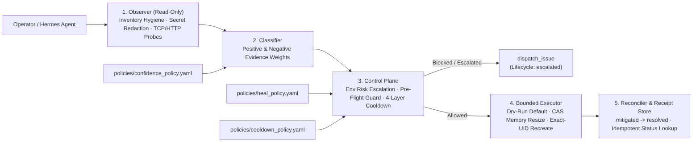

# hermes-sre-agent

A policy-driven, **Kubernetes & Standalone Docker Service Diagnosis & Bounded Self-Healing Agent** built for [Hermes Agent](https://github.com/NousResearch/hermes-agent) and standalone CLI/CI workflows.

Instead of letting an LLM freestyle destructive `kubectl delete` or `kubectl patch` commands in a shell, `hermes-sre-agent` separates intent routing from a **deterministic 5-stage SRE control plane** governed by three declarative YAML policies.

## Architecture



### Core Engineering Pillars

- **5-Stage Decoupled Pipeline & 5-State Incident Lifecycle**: Strictly separates `Observation ≠ Classification ≠ Policy Gate ≠ Bounded Action ≠ Reconciliation`. API acceptance (`mitigated`) is never conflated with verified service recovery (`resolved`).
- **Positive & Negative Evidence Confidence Scoring (`policies/confidence_policy.yaml`)**: Prevents common Kubernetes false positives — for example, `OOMKilled` (`exitCode=137`) paired with `Startup probe failed` applies a `-0.60` negative weight so slow-starting pods are not blindly resized; `ImagePullBackOff` paired with `manifest unknown` blocks futile pod deletion.
- **Environment-Aware Risk & Approval Gate (`policies/heal_policy.yaml`)**: `dev` / `staging` allow low- and medium-risk bounded actions automatically, while `prod` automatically upgrades risk by one tier, multiplies cooldown windows by `3x`, and enforces explicit approval (`--approve`).
- **4-Layer Anti-Avalanche Circuit Breaker (`policies/cooldown_policy.yaml`)**:
  1. **Same Pod + Same Root Cause** (`24h`): stops single-pod heal loops.
  2. **Same Pod + Any Root Cause** (`12h`): escalates multi-root complex failures.
  3. **Same Deployment Rate-Limit** (`6h`, max 1 pod): prevents wiping out an entire replica set.
  4. **Cluster Pressure Panic Breaker** (`5 actions / 1 min`): halts automation immediately during cascading outages.
- **Bounded Mutations & Pre-Flight Guards**:
  - **OOM Resize (`resize_memory`)**: enforces `[512Mi, 16384Mi]` floor/ceiling, node allocatable memory, namespace quota remaining, `resourceVersion` CAS checks, and refuses infinite scaling on recurrent OOMs.
  - **Pod Recreate (`recreate_pod`)**: scans startup logs/events before deletion to block blind restarts on deterministic config or code errors (`Could not resolve placeholder`, `NoClassDefFoundError`, etc.).
- **Idempotent Receipt Store & Inventory Hygiene**: Actions are keyed by `sha256(request_id:pod_uid:action)` so timeouts query `hermes-sre status --request-id <id>` instead of replaying mutations. Namespace inventory excludes Ready pods with historical restarts, separates `<5m` startup and `<=10m` termination transitions, and redacts tokens/passwords from logs.
- **Hermes Native Skill & Self-Modification Guardrails**: Ships [`hermes/skills/hermes-sre-agent/SKILL.md`](hermes/skills/hermes-sre-agent/SKILL.md) and [`hermes/SOUL.guardrails.md`](hermes/SOUL.guardrails.md) (protecting `SOUL.md`, `MEMORY.md`, and `config.yaml` from self-modification).
- **Zero Python Dependencies**: Pure Python 3.10+ standard library (with an embedded deterministic YAML subset parser when PyYAML is not installed).

## Built-In 6-Scenario Fault-Injection Benchmark

Run all 6 offline incident scenarios deterministically (no live cluster required):

```bash
hermes-sre benchmark --format markdown
```

Verified output (`6/6` passed, `100.0%`):

| Scenario | Env | Root Cause | Conf | Action | Guardrail / Blocked By | Lifecycle | Pass |
| --- | --- | --- | ---: | --- | --- | --- | :---: |
| `01-true-oomkilled` (True OOMKilled -> Bounded CAS Memory Resize) | `staging` | `OOM_KILLED` | 1.00 | `resize_memory` | `allowed` | `resolved` | PASS |
| `02-probe-false-oom` (Startup Probe SIGKILL Masquerading as OOM) | `staging` | `UNKNOWN` | 0.40 | `dispatch_issue` | `confidence_threshold` | `escalated` | PASS |
| `03-config-missing-block` (Missing Config Placeholder -> Block Blind Delete) | `staging` | `CONFIG_MISSING` | 0.98 | `dispatch_issue` | `infra_heal_boundary` | `escalated` | PASS |
| `04-transient-mount-heal` (Transient Volume subPath Failure -> Exact-UID Recreate) | `staging` | `TRANSIENT_MOUNT` | 1.00 | `recreate_pod` | `allowed` | `resolved` | PASS |
| `05-code-defect-dispatch` (NoClassDefFoundError -> Infra Boundary Escalation) | `staging` | `CODE_DEFECT` | 1.00 | `dispatch_issue` | `infra_heal_boundary` | `escalated` | PASS |
| `06-avalanche-circuit-break` (Cascading Storm -> Cluster Panic Circuit Breaker) | `staging` | `TRANSIENT_IMAGE_PULL` | 1.00 | `dispatch_issue` | `cooldown:cluster_pressure` | `escalated` | PASS |

## Hermes Agent End-to-End Example

With the skill linked into `~/.hermes/skills/hermes-sre-agent`:

```bash
hermes chat -s hermes-sre-agent -Q -q \
  "Use hermes-sre to diagnose pod search-worker-6d5c4b-9p8q1 in namespace apps (env staging) \
   using offline scenario scenarios/02-probe-false-oom.json, and explain whether auto-healing is allowed."
```

Hermes invokes `hermes-sre diagnose` deterministically, catches the negative evidence (`Startup probe failed` lowering `OOM_KILLED` confidence to `0.40 < 0.75`), blocks automated memory resizing (`blocked_by=confidence_threshold`), and escalates for startup-probe investigation without touching the cluster.

## Quick Start

### Prerequisites

- Python `>= 3.10`
- `kubectl` (for live Kubernetes targets) or `docker` CLI (for standalone Docker / `docker compose` hosts, including remote hosts via `--docker-host ssh://user@host`); offline scenarios run with zero external tools
- Optional: [Hermes Agent](https://github.com/NousResearch/hermes-agent) for interactive chat / skill execution

### Install

```bash
pip install -e .
# or with uv:
uv tool install --editable .
```

Or run directly without installing:

```bash
PYTHONPATH=src python3 -m hermes_sre.cli benchmark --format markdown
```

### Install Hermes Skill & Guardrails

```bash
ln -sfn "$(pwd)/hermes/skills/hermes-sre-agent" ~/.hermes/skills/hermes-sre-agent
```

Optionally merge [`hermes/SOUL.guardrails.md`](hermes/SOUL.guardrails.md) into `~/.hermes/SOUL.md`.

### CLI Usage

```bash
# 1. Read-only namespace inventory (live cluster or offline --scenario)
hermes-sre inventory --namespace apps --env staging --scenario scenarios/01-true-oomkilled.json --format markdown

# 2. Read-only single-pod diagnosis (with optional downstream TCP/HTTP probes)
hermes-sre diagnose \
  --namespace apps \
  --env staging \
  --pod checkout-api-7f8b9c-x4k2p \
  --dep tcp:redis:127.0.0.1:6379 \
  --scenario scenarios/01-true-oomkilled.json \
  --format markdown

# 3. Safe dry-run heal plan (default: no cluster mutation)
hermes-sre heal \
  --namespace apps \
  --env staging \
  --pod checkout-api-7f8b9c-x4k2p \
  --request-id inc-2026-001 \
  --scenario scenarios/01-true-oomkilled.json

# 4. Execute approved bounded heal (--apply; prod also requires --approve)
hermes-sre heal \
  --namespace apps \
  --env staging \
  --pod checkout-api-7f8b9c-x4k2p \
  --request-id inc-2026-002 \
  --scenario scenarios/01-true-oomkilled.json \
  --apply

# 5. Inspect persisted idempotent receipt instead of replaying on timeout
hermes-sre status --request-id inc-2026-002
```

### Standalone Docker / Docker Compose Usage

The same 5-stage diagnosis, guardrails, cooldowns, and interactive follow-up (`next_steps`) work on standalone Docker hosts via `--runtime docker` (`--namespace` maps to Compose project, `standalone`, or `all`; `--pod` maps to container name):

```bash
# Scan abnormal containers on a local or remote SSH Docker host
hermes-sre inventory --runtime docker --docker-host ssh://ops@server-01 --format markdown

# Diagnose a single container (reads inspect, healthcheck logs, docker events, and container logs)
hermes-sre diagnose --runtime docker --pod shop-orders-1 --format markdown

# Dry-run first, then apply bounded memory update / container-ID-guarded restart
hermes-sre heal --runtime docker --pod shop-orders-1 --request-id inc-docker-001 --format markdown
hermes-sre heal --runtime docker --pod shop-orders-1 --request-id inc-docker-002 --apply
```

## Running Tests

```bash
PYTHONPATH=src python3 -m unittest discover -s tests -v
```

## License

[MIT](LICENSE)
